<!-- Hero Card -->

  

<!-- Three Linked Tiles in a Row (Width 32.5% Each) -->

  
  
  

 

<!-- 12-Month GitHub Contributions Chart & Streak Metrics -->

  

<!-- 52-Week Contribution Heatmap in Brand Blue -->

